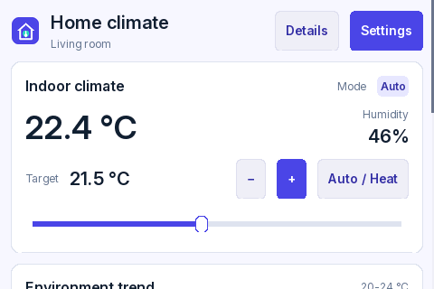
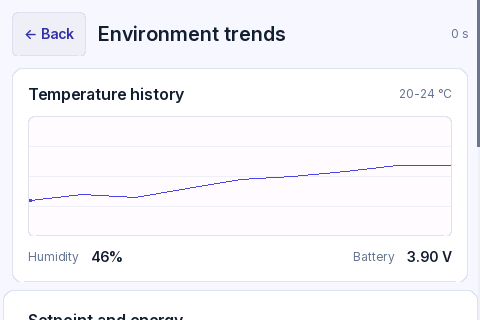
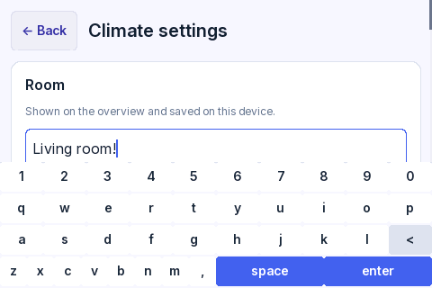
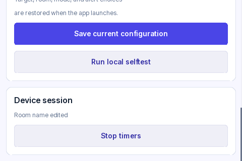
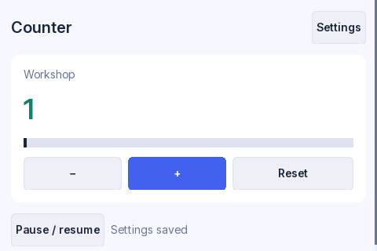
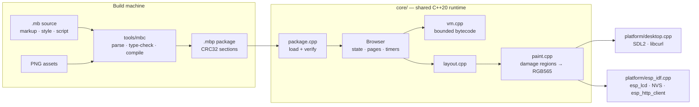

<div align="center">

# Microbrowser

**Browser-style interactive apps for microcontrollers.**<br>
Write pages in markup, style them with classes and script them with a small typed language.<br>
The host compiler packs them into a verified binary bundle that an ESP32-S3 renders without V8, a DOM or a runtime parser.


[](LICENSE)


<sub>Real framebuffer output from <code>build/microbrowser --headless</code> replaying scripted touch input; nothing is mocked up.<br>
Regenerate it with <code>tools/capture_screenshots.py</code>.</sub>

[Quick start](#quick-start) ·
[Hello, counter](#hello-counter) ·
[Features](#features) ·
[Architecture](#architecture) ·
[ESP32-S3 &amp; QEMU](#esp32-s3-and-qemu) ·
[Authoring guide](docs/authoring.md) ·
[Package format](docs/package-format.md)

</div>

---

## Why Microbrowser?

Modern browser engines need hundreds of megabytes. A microcontroller has a few hundred kilobytes of SRAM and a few megabytes of PSRAM. Microbrowser keeps the parts of the web model that make UIs pleasant to build—pages, links, history, classes, bindings, event handlers and animations—and moves everything expensive to the build machine:

| Done on your computer by `mbc` | Done on the device by the runtime |
|---|---|
| Parse markup, styles and script | Load a CRC-checked binary package |
| Type-check script, compile to bytecode | Run bounded bytecode in event handlers |
| Resolve classes into per-node styles | Lay out rows, columns and stacks |
| Decode and resize PNGs into RGB565 | Blit pixels; no image decoder |
| Rasterize Inter into glyph tables | Draw antialiased text; no font engine |
| Validate size and structural limits | Repaint only damaged regions |

The result is an **authored-application browser**. It does not load arbitrary websites; see [Scope](#scope).

## Gallery

<table>
  <tr>
    <td align="center"><br><sub>Dashboard: bindings, buttons, slider and pulse animation</sub></td>
    <td align="center"><br><sub>Second page: live chart and history navigation</sub></td>
  </tr>
  <tr>
    <td align="center"><br><sub>Text input with the built-in on-screen keyboard</sub></td>
    <td align="center"><br><sub>Touch-scrolled settings with persisted values</sub></td>
  </tr>
  <tr>
    <td align="center"><br><sub>The same package on an emulated ESP32-S3 virtual LCD</sub></td>
    <td align="center"><br><sub>The tutorial counter app from the authoring guide</sub></td>
  </tr>
</table>

## Quick start

Requires a C++20 compiler, GNU Make, Python 3, SDL2 and libcurl (`sdl2-config` and `curl-config` on `PATH`). The compiler uses only the Python standard library.

```sh
# macOS:          brew install sdl2 curl
# Debian/Ubuntu:  sudo apt install build-essential libsdl2-dev libcurl4-openssl-dev python3

git clone https://github.com/leopck/microbrowser.git
cd microbrowser
make                                                        # builds build/microbrowser
python3 tools/mbc run examples/dashboard.mb -- --size 480x320
```

The mouse acts as a finger: click to press, drag to scroll and click an input to open the keyboard. <kbd>Enter</kbd> submits, <kbd>Esc</kbd> dismisses and <kbd>F1</kbd> toggles layout/render timing.

## Hello, counter

One `.mb` file holds the state, styles, pages and script. This is trimmed from [`examples/counter.mb`](examples/counter.mb):

```xml
<microbrowser name="Counter">
  <state>
    <field name="value" type="f32" value="0"/>
    <field name="status" type="string" value="Ready"/>
  </state>

  <style>
    .card    { background: white; radius: 12; padding: 16; gap: 12; }
    .reading { font-size: 36; font-weight: 600; color: accent; }
    .button  { background: #E9EDF5; color: ink; height: 42; radius: 8; }
  </style>

  <page name="home">
    <column class="card" animate="fade:180">
      <text class="reading" bind="{state.value}" format="%.0f"/>
      <progress bind="{state.value}" min="0" max="100" height="12"/>
      <row>
        <button class="button" text="−" width="grow" on_press="decrease()"/>
        <button class="button" text="+" width="grow" on_press="increase()"/>
      </row>
      <text bind="{state.status}"/>
    </column>
  </page>

  <script><![CDATA[
    fn change_value(delta) {
      state.value = clamp(state.value + delta, 0, 100);
      state.status = "Value: " + string(state.value);
    }
    fn increase() { change_value(1); }
    fn decrease() { change_value(-1); }
  ]]></script>
</microbrowser>
```

```sh
python3 tools/mbc run examples/counter.mb -- --size 480x320   # compile and open
python3 tools/mbc build examples/counter.mb -o build/counter.mbp
python3 tools/mbc inspect build/counter.mbp                    # validate and summarize
```

Assigning to `state.value` repaints only the widgets bound to it. Compile errors report `file:line:column`. The [authoring guide](docs/authoring.md) builds the full two-page version step by step, including settings, navigation and persistence.

## Features

**UI**
- Widgets: `text`, `button`, `input`, `slider`, `progress`, `chart`, `image` and `spacer`
- Layout: `row`, `column` and `stack`; fixed, percentage and `grow` sizing; padding, gap and overlay placement
- Styling: reusable classes, inline attributes, a named palette and `#RRGGBB`, rounded corners and borders
- Antialiased Inter text at 12–36 px in regular and semibold, with word wrap and kerning

**Interaction**
- Touch/pointer input and drag scrolling with a tap/scroll threshold
- Built-in on-screen keyboard, caret editing, `max-length`, `on_change` and `on_submit`
- Multi-page apps with `go("page")`, `back()` and bounded history

**Behaviour**
- Declarative `{state.x}` bindings with per-widget invalidation
- `fade`, `slide` and `pulse` animations evaluated natively each frame without running script
- Typed script: `f32`, `bool` and `string`, functions, `if`/`while`, timers, HTTP(S) with JSON paths and persistent storage
- Hard limits on instructions, stack, locals, call depth, timers and in-flight requests

**Tooling**
- `mbc build | inspect | run` compiler CLI
- Headless replay of scripted input with framebuffer screenshots (`--events`, `--screenshot`)
- SPI bandwidth estimation (`--spi-hz`) and a live metrics overlay
- ESP32-S3 firmware with a virtual LCD, an emulated Ethernet network and an automated QEMU self-test

## Architecture



The `Platform` interface ([`include/microbrowser/platform.h`](include/microbrowser/platform.h)) is the porting boundary. It provides the clock, logging, storage and asynchronous HTTP; the rest of `core/` is identical on desktop and device.

**Rendering model.** State writes, animations, caret blinks and presses add regions to a damage list of at most 32 rectangles. Each `tick()` repaints only those regions into the RGB565 framebuffer, and the platform pushes only those regions to the display. Layout runs again only after structural changes such as navigation, scrolling or auto-sized text changes.

## Footprint

Measured with the bundled climate dashboard (3 pages, 141 nodes, 29 functions):

| Metric | Value | Source |
|---|---|---|
| Compiled package | 15,581 bytes | `mbc build` |
| Internal heap free after start | 216,923 bytes | QEMU `MICROBROWSER_QEMU_READY` |
| Internal heap low-water mark | 179,872 bytes | same |
| Framebuffer, 480×320 RGB565 | 307,200 bytes in PSRAM | runtime report |
| Main-task stack headroom | 6,240 bytes | same |
| Desktop layout pass | ~0.1 ms | `--headless` report on an Apple-silicon host |

QEMU and desktop timings are not ESP32 performance claims. Measure frame rate on your target panel; on SPI displays, the bus is usually the limit. `--spi-hz` estimates that ceiling.

## ESP32-S3 and QEMU

The firmware in [`firmware/`](firmware/) uses ESP-IDF 6.1 and Espressif's QEMU fork. After installing [ESP-IDF and its QEMU tools](https://docs.espressif.com/projects/esp-idf/en/stable/esp32s3/api-guides/tools/qemu.html):

```sh
export IDF_PATH=/path/to/esp-idf
make qemu
```

This builds the dashboard package and firmware, then boots an emulated ESP32-S3 with 8 MiB PSRAM and a 480×320 virtual LCD. Over UART, it drives navigation, scrolling, persistence and the app's self-test. It then saves the LCD as `build/qemu-dashboard.ppm`.

| Command | Purpose |
|---|---|
| `make firmware` | Build only |
| `firmware/run.sh --graphics` | Boot QEMU with a visible display window |
| UART `page`, `stats`, `selftest`, `call NAME` | Inspect or drive a running device |

> **Porting to a real board:** [`firmware/main/main.cpp`](firmware/main/main.cpp) creates the QEMU RGB panel (`esp_lcd_rgb_qemu`). For hardware, replace it with your panel's `esp_lcd` driver and feed touch events to `Browser::pointer_down/move/up`. Layout, drawing, scripts, storage and networking need no changes.

## Testing

```sh
make test   # compiler unit tests, C++ runtime tests and headless UI replays
make qemu   # embedded build plus emulator interaction and LCD capture
```

`make test` replays [`tests/dashboard.events`](tests/dashboard.events) and [`tests/counter.events`](tests/counter.events). These scripts simulate real clicks, drags and typing against the compiled packages and fail on any script error or self-test failure. Write your own with `click`, `down`, `move`, `up`, `text`, `key`, `scroll`, `call`, `wait` and `shot`:

```sh
./build/microbrowser --package build/counter.mbp --headless --size 480x320 \
  --frames 200 --events tests/counter.events --screenshot build/counter.ppm
```

To refresh the desktop screenshots and `demo.gif` from real replays, install Pillow (`pip install -r tools/requirements-fonts.txt`) and run `python3 tools/capture_screenshots.py`. `qemu-dashboard.png` is a conversion of the `build/qemu-dashboard.ppm` written by `make qemu`.

## Scope

Microbrowser is **not** a web browser for existing sites. It has no HTML/CSS/JS compatibility, DOM, selectors, `eval` or arbitrary URL loading. These limits make it small and predictable:

- Every app is compiled ahead of time; the device never parses source text.
- Script runs only in response to events and timers, under fixed instruction and memory budgets.
- Element IDs are scoped to the current page, and widgets bind only to declared, typed state.
- The bundled glyph set is fixed; unsupported characters render as `?`.

The limits and rationale are documented in the [authoring guide](docs/authoring.md).

## Repository layout

| Path | Contents |
|---|---|
| [`core/`](core/), [`include/microbrowser/`](include/microbrowser/) | Runtime: package loader, browser, layout, paint, input, VM and fonts |
| [`platform/`](platform/) | Desktop (SDL2/libcurl), headless event replay and ESP-IDF platform implementations |
| [`tools/mbc/`](tools/mbc/) | Compiler and inspector (`python3 tools/mbc`) |
| [`tools/`](tools/) | QEMU smoke test, screenshot capture and font-table generator |
| [`examples/`](examples/) | Climate dashboard and counter tutorial apps |
| [`firmware/`](firmware/) | ESP-IDF project for ESP32-S3 |
| [`tests/`](tests/) | Compiler, runtime, font and replay tests |
| [`docs/`](docs/) | [Authoring guide](docs/authoring.md), [package format](docs/package-format.md) and screenshots |
| [`third_party/inter/`](third_party/inter/) | Inter font source and [license notes](third_party/inter/README.md) |

## Contributing

Issues and pull requests are welcome. Before you open a pull request:

1. Run `make test`; run `make qemu` too if you changed `core/`, `platform/esp_idf.cpp` or `firmware/`.
2. Add or update a replay in `tests/*.events` for user-visible behavior.
3. If you changed the language or binary layout, update [`docs/authoring.md`](docs/authoring.md) or [`docs/package-format.md`](docs/package-format.md).
4. If your change affects UI output, run `tools/capture_screenshots.py`.

Generated font data in `core/font_data.cpp` is produced by `tools/build_fonts.py`; regenerate it rather than editing it by hand. See [`third_party/inter/README.md`](third_party/inter/README.md).

## Acknowledgements

- [Inter](https://github.com/rsms/inter) by Rasmus Andersson, used under the SIL Open Font License 1.1
- [ESP-IDF](https://github.com/espressif/esp-idf) and [Espressif QEMU](https://github.com/espressif/qemu)
- [SDL2](https://www.libsdl.org/) and [libcurl](https://curl.se/libcurl/) for the desktop runtime

## License

Microbrowser is released under the [MIT License](LICENSE). The bundled Inter font keeps its own [SIL Open Font License 1.1](third_party/inter/OFL.txt).
