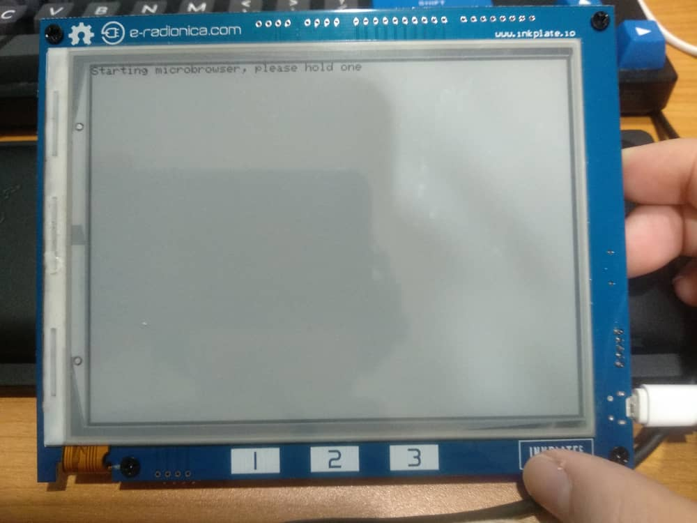
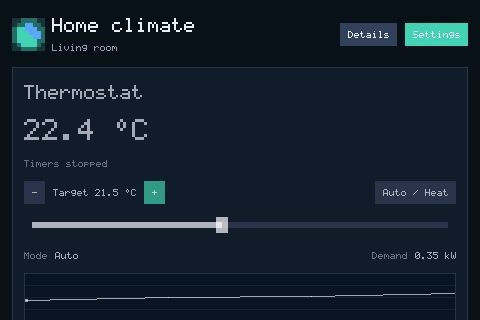

# microbrowser
Microbrowser for Microcontroller
# Microbrowser

WIP, does not work for now.
Microbrowser is a browser-like application runtime for small displays, written
for ESP32-S3-class devices. Applications use familiar UI markup, CSS-like
classes, and event-driven scripts. A host compiler turns them into one bounded
binary package. The device does not parse HTML, CSS, scripts, or PNG files.

# Status
This is an authored application platform, not a Chrome-compatible browser.
Buttons, text inputs, sliders, lists, dashboards, graphs, images, navigation,
animations, HTTP(S), storage, and touch are in scope. Arbitrary modern websites
and full browser JavaScript compatibility are not.

- litehtml is now able to compile on ESP32 and Arduino
- Inkplate on Arduino is working
- Currently implementing litehtml document_container to use Inkplate rendering to draw onto the display from the output of the HTML container_esp32_inkplate
## Development without hardware

# About this project
Build the native program, compile the example application, and open the SDL
window:

A Microbrowser that is able to render HTML5 and CSS3 on a Microcontroller (ESP32). No Javascript support for now.
```sh
make
python3 tools/mbc build examples/dashboard.mb -o build/dashboard.mbp
./build/microbrowser --package build/dashboard.mbp --scale 2
```


For a graphical desktop loop with automatic package rebuilding:

Recently I just received my Inkplate 6 from CrowdSupply, an E-paper powered by ESP32 and wanted to browse my website from my Inkplate.
```sh
make dashboard
```

# How does it work?
The window maps pointer events to touch events. Type into focused text fields,
or use the on-screen keyboard.

Drag vertically to scroll a scrollable container. Dragging over a button cancels
its click once scrolling starts; slider gestures continue to edit the slider.
F1 displays host-side render/layout timing, element count, and outstanding
request count. These are **desktop diagnostics**, not measured ESP32 performance.

- litehtml for rendering the HTML
- Inkplate library for rendering the text and graphics onto the E-paper
- (Future) LGVL - Light and Versatile Graphics Library https://lvgl.io/
### Headless interaction and screenshots

# Getting Started
```sh
./build/microbrowser --package build/dashboard.mbp \
  --headless --frames 120 --screenshot build/dashboard.ppm
```

## Requirement
- Docker
The screenshot is a binary PPM image containing the actual RGB565 framebuffer,
not a mock-up. `--size 480x320` selects the logical target; `--scale 2` scales
only the desktop window. A replay file with `click`, `down`, `move`, `up`,
`wait`, `key`, `text`, `call`, `scroll`, and `shot` commands can be supplied
with `--events`.

## Compiling and Uploading to your Inkplate ESP32
`--spi-hz 40000000` prints display-bus estimates based on transmitted pixels.
They describe the modeled bandwidth. The virtual framebuffer does not model a
physical LCD controller or prove real-device frame rate.


### Repository captures



Additional 480×320 framebuffer views:

- [Native dashboard](docs/screenshots/native-dashboard.png)
- [Environment trends](docs/screenshots/native-details.png)
- [Focused text input and on-screen keyboard](docs/screenshots/native-input.png)
- [Settings after a vertical drag](docs/screenshots/native-scrolled-settings.png)

The native views use `tests/dashboard.events`. The firmware view uses the QEMU check below.

### ESP32-S3 in QEMU

The firmware uses ESP-IDF and Espressif's QEMU fork, not stock QEMU. Install the
[ESP-IDF QEMU prerequisites and tools](https://docs.espressif.com/projects/esp-idf/en/stable/esp32/api-guides/tools/qemu.html),
including `qemu-xtensa`. Then export ESP-IDF and build the dashboard:

```sh
. /path/to/esp-idf/export.sh
python3 tools/mbc build examples/dashboard.mb -o build/dashboard.mbp
firmware/run.sh [--graphics]
```
git clone https://github.com/leopck/microbrowser/
docker run -it --rm --privileged -v /dev/ttyUSB0:/dev/ttyUSB0 -v $PWD/microbrowser/:/go/microbrowser arduino-cli

The target uses ESP32-S3, a virtual 480x320 RGB565 LCD, and `idf.py qemu`.
The QEMU model uses 8 MiB of PSRAM to leave address space for flash/NVS
mappings. It provides OpenCores Ethernet in place of Wi-Fi; HTTPS certificate
validation remains enabled. Build-time and runtime limits are documented with
the firmware entry point.

The launcher uses SDL's dummy backend by default, so LCD updates complete
without a desktop window. Pass `--graphics` for a visible SDL window.
The UART accepts CR, LF, and CRLF line endings.

For an automated headless boot, UART interaction/self-test, and virtual LCD
dump, run `make qemu`. The screenshot is `build/qemu-dashboard.ppm`.

For an automated headless boot, UART interaction/self-test, and virtual LCD
dump, run `make qemu`. The screenshot is `build/qemu-dashboard.ppm`.

## Authoring

```xml
<microbrowser name="Home">
  <state>
    <field name="temperature" type="f32" value="22.4"/>
    <field name="room" type="string" value="Living room"/>
  </state>
  <style>
    .card { background: #182232; padding: 12; radius: 10; gap: 8; }
  </style>
  <page name="home">
    <column class="card" on_load="start()">
      <text text="Bedroom" font-size="2" />
      <text text="{state.temperature}" format="%.1f °C" font-size="3" />
      <button text="Settings" on_press="open_settings()" />
    </column>
  </page>
  <script><![CDATA[
    fn start() { every(1000, "refresh"); }
    fn refresh() { log("refresh"); }
    fn open_settings() { go("settings"); }
  ]]></script>
</microbrowser>
```

## Compile only
Compile and inspect the resulting package:

```sh
python3 tools/mbc build app.mb -o app.mbp
python3 tools/mbc inspect app.mbp
```
git clone https://github.com/leopck/microbrowser/
docker run -it --rm --privileged -v /dev/ttyUSB0:/dev/ttyUSB0 -v $PWD/microbrowser/:/go/microbrowser arduino-cli make compile

See [the authoring guide](docs/authoring.md) for the complete source grammar and
[the package specification](docs/package-format.md) for its binary contract.
The compiler works from any directory and resolves asset paths relative to the
`.mb` source file.

## Runtime design

- **Precompiled packages.** CRC32-checked sections contain UTF-8 strings,
  shared state, bytecode, page trees, and RGB565 image assets.
- **Retained layout.** Row, column, stack, absolute, fixed, percentage, and
  flexible sizing operate on unique-owned nodes. Bound-state changes repaint
  only the affected boxes; they do not force a reflow every frame.
- **RGB565 rendering.** Tiled damage regions feed the same framebuffer on SDL
  and ESP32-S3. Images and glyphs require no per-frame decoding or allocation.
- **Native animation.** Opacity, scale, and vertical offset use monotonic
  time, separate from UI-thread networking and event scripts.
- **Bounded scripts.** A typed bytecode interpreter enforces instruction,
  call-depth, local, and operand limits. Network, timer, and storage calls have
  explicit types and errors, not null/-1 failure sentinels.
- **Asynchronous I/O.** A bounded request queue sends at most eight HTTP(S)
  requests. Results are consumed at controlled points in the UI task.
- **Resource limits.** Packages, document depth/width, response bodies, JSON
  nesting, timers, requests, history, and chart series all have hard limits.

## Tests

```sh
make dashboard
make test
python3 -m unittest discover -s tests -p 'test_*.py'
```

The C++ runtime tests exercise real compiled packages through parsing,
rendering, pointer/keyboard input, state binding, navigation, persistence,
network completion, animation, and script resource limits. Compiler tests
cover source diagnostics, class precedence, scripts, and PNG conversion.

No performance measurement on an ESP32 is implied by desktop or QEMU results.
