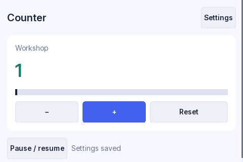

# Building Microbrowser applications

Microbrowser applications are authored in `.mb` files. XML-like markup describes
pages and controls, class rules describe appearance, and a small typed script
language handles events and shared data. `tools/mbc` compiles everything into a
version-2 `.mbp` package for the desktop runtime or an embedded integration.

The syntax is intentionally browser-like, but this is not HTML, CSS or
JavaScript. A `<page>` is a screen inside your application, not an Internet URL.
The package compiler, not the display, understands XML, styles, scripts and PNG
files. At runtime, the device lays out and paints retained nodes, executes
compiled bytecode and performs platform operations.

This guide starts with a runnable application, then documents the complete
authoring model. If you are specifically implementing or inspecting the binary
format, use [the package specification](package-format.md).

## 1. Run the complete example first

From the repository root, build the desktop runtime and then compile and run the
counter application:

```sh
make
python3 tools/mbc build examples/counter.mb -o build/counter.mbp
python3 tools/mbc inspect build/counter.mbp
python3 tools/mbc run examples/counter.mb -- --size 480x320
```

The source is [examples/counter.mb](../examples/counter.mb). It contains:

- A **home** page with a live numeric reading, a progress track, increment,
  decrement and reset buttons, a pause/resume control and a status line.
- A **settings** page with an editable name and a slider for the counting step.
- Shared application state visible from either page.
- Typed persistent values, explicit save/restore controls and a local `report`
  function that prints the counter through desktop/UART logging.



The package is only a few kilobytes because assets, glyphs and bytecode are
compiled in advance. `inspect` prints the version, state declarations, function
counts, pages, assets and checksum. It is useful when a change compiles but does
not have the structure you expected.

The desktop defaults to `.microbrowser-state` for persistent records. To keep
experiments separate, use a different file:

```sh
MB_STATE_FILE=build/counter-state \
  python3 tools/mbc run examples/counter.mb -- --size 480x320
```

### Turn the example into your application

Copy the example and work from the copy:

```sh
cp examples/counter.mb examples/my_counter.mb
python3 tools/mbc inspect examples/my_counter.mb
```

Then make these kinds of changes, rebuilding after each one:

1. Change `<microbrowser name="Counter">` to your application name.
2. Change the page headings and literal button labels.
3. Replace the `state` declarations with your own typed values.
4. Adjust `.card`, `.button` and other class declarations to define your visual
   style. These are supported class rules, not general CSS.
5. Edit the functions for your actions. Keep event attributes calling declared
   zero-argument functions. Use small parameter-taking helpers such as
   `change_value(delta)` for shared behavior.
6. Rename pages consistently in both `<page name="...">` and `go("...")`.
7. Give persistence keys your own prefix, such as `my_counter.value` instead of
   `counter.value`, so unrelated applications do not accidentally share records.

No step requires changing the runtime. The entire example is ordinary
Microbrowser source.

## 2. The compiler and desktop commands

`tools/mbc` has three commands:

```sh
# Compile a source file. With no -o, the suffix changes from .mb to .mbp.
python3 tools/mbc build path/to/app.mb
python3 tools/mbc build path/to/app.mb -o build/app.mbp

# Validate and summarize a package.
python3 tools/mbc inspect build/app.mbp

# Or validate source without writing a package.
python3 tools/mbc inspect path/to/app.mb

# Build and launch the desktop application. Arguments after -- go to it.
python3 tools/mbc run path/to/app.mb -- --size 480x320
```

Run these commands with the repository's `tools/mbc` path. By default, `run`
looks for `build/microbrowser`; run `make` first if that executable is missing.
The `--size` option accepts dimensions from 64 through 2048 pixels per axis.
The size is the logical canvas, not a DPR or font-scale setting. `--scale 2`
scales the desktop window without changing that logical canvas.

Source and asset paths are resolved relative to the `.mb` source file, not the
shell's current directory. Diagnostics have the form
`path:line:column: message`. Compilation and validation errors are raised before
writing a new package. An older output file is not automatically removed when a
new build fails; filesystem write failures are not transactional.

The source and each PNG input file are each limited to 16 MiB. The finished
package is also limited to 16 MiB, including its sections and converted assets.
Unrecognized XML elements, properties, functions, types or binding targets are
errors rather than browser-like silent recovery.

## 3. Anatomy of an `.mb` document

The example begins with these four parts before reaching its two pages:

```xml
<microbrowser name="Counter">
  <state>
    <field name="value" type="f32" value="0"/>
    <field name="step" type="f32" value="1"/>
    <field name="name" type="string" value="Workshop"/>
  </state>

  <style>
    .card { background: white; radius: 12; padding: 16; gap: 12; }
    .title { font-size: 20; font-weight: 600; }
  </style>

  <page name="home">
    <column class="screen">
      <row class="toolbar">
        <text class="title" text="Counter"/>
        <spacer/>
        <button class="button" text="Settings" on_press="open_settings()"/>
      </row>
    </column>
  </page>

  <script><![CDATA[
    fn open_settings() {
      go("settings");
    }
  ]]></script>
</microbrowser>
```

The `<microbrowser>` element requires a nonempty `name` attribute.

The fragment illustrates the grammar, not a complete application: the full
source defines the referenced classes, the `settings` page and additional
controls. `state`, `style` and `script` are optional. Pages are required. There
can be one state block, one style block and one script block. Assets, when used,
must precede all pages. The first `<page>` is the initial screen, and page names
must be unique.

Each page has exactly one root element. Its root can have `on_load`. Other
elements cannot have `on_load`; they use events appropriate to their widget.

Use UTF-8, well-formed XML. Visible text belongs in `text`, `value`, `bind` or
`placeholder` attributes, **not** in element content. Thus `<text>Hello</text>`
is invalid, while `<text text="Hello"/>` is valid. Whitespace between elements
is ignored. Character content is rejected inside state fields and other places
that require structured content.

XML character references such as `&amp;`, `&lt;` and `&gt;` are decoded before
strings are stored. Use CDATA around scripts so `<`, `&&` and related characters
remain source text rather than XML markup. XML namespaces and general entity
declarations are not part of the application format.

### State

State fields are the typed data shared by all pages. Their names are unique
C-like identifiers: a letter or underscore followed by letters, digits or
underscores. `state` itself is reserved. Scripts use `state.field_name` to read
or assign a field. There is no nested state object, array or dynamic property
lookup.

| `type` | Value | Meaning |
|---|---|---|
| `f32` | Finite decimal number | Binary32 number used for calculations, sliders, progress and charts |
| `bool` | `true` or `false` | Boolean conditions and typed persistence |
| `string` | Literal text | UTF-8 text, storage, responses and labels |

There can be at most 256 state fields. All initial values are explicit. State is
allocated with the loaded package; every page uses the same field set.

## 4. Elements and controls

| Element | Purpose and required content |
|---|---|
| `view`, `column` | Vertical container; these two kinds lay out children vertically |
| `row` | Horizontal container |
| `stack` | Overlays children; non-absolute children normally fill its content box |
| `text` | Literal or bound text; optional `format` for bound text |
| `button` | Literal `text` and optional `on_press` |
| `input` | String-state binding; optional `placeholder`, `max-length`, `on_change` and `on_submit` |
| `slider` | Numeric-state binding with `min`, `max`, `step` and optional `on_change` |
| `progress` | Numeric-state binding with required ordered `min` and `max` |
| `chart` | Bounded numeric series with `samples`, `min` and `max`; give it an `id` when using `chart_push` |
| `image` | `src` must name a declared `<asset>`, not a file path |
| `spacer` | Consumes available main-axis space, like a grow item |

All elements accept the common layout, appearance and event-related properties
documented below. Invalid child relationships are rejected: only containers may
have element children. There is no arbitrary child markup inside a button.

### Text and bindings

These are equivalent bindings for text:

```xml
<text text="{state.temperature}"/>
<text value="{state.temperature}"/>
<text bind="{state.temperature}"/>
```

The binding must be the **entire attribute value**. Interpolation is not general
string interpolation: `text="Temperature: {state.temperature}"` is literal
text, not a bound expression. Use a separate `<text>` for the prefix or use
`format` to surround a numeric value:

```xml
<text bind="{state.temperature}" format="%.1f °C"/>
```

Buttons accept literal text only. To change a button's label from script,
navigate to another page or display a separate bound text element; there is no
arbitrary DOM property assignment in the script language.

The `format` attribute is for **bound text only**. If present, it must contain
exactly one conversion. Other text is copied literally, and `%%` produces one
percent sign:

| Conversion | Meaning |
|---|---|
| `%f` | Numeric value with six decimal places |
| `%.0f` through `%.6f` | Numeric value with the requested decimal precision |
| `%d` | Binary32 value rounded to the nearest integer, not truncated |
| `%s` | A string state value |

Numeric state requires a numeric conversion; string state requires `%s`; a
`format` is not supported on a boolean binding. Omit `format` for the default:
numbers use three decimal places and then trim trailing zeros and a trailing
decimal point; booleans appear as `true` or `false`. An explicitly supplied empty
`format` is invalid because it contains no conversion.

For `%d`, the number must also fit in the signed 64-bit integer range. Formatting
errors are reported rather than producing an overflowing integer result.

Long formatted results are bounded by measurement and paint buffers and can be
shortened without an ellipsis. Keep values intended for small screens concise
and give tightly sized text nodes careful bounds. `len()` counts Unicode
codepoints, not bytes or grapheme clusters.

### Controls and user changes

Input requires a string binding, and slider/progress require a numeric binding.
`max-length` on an input defaults to 64 and counts Unicode codepoints. Pasting is
truncated at the remaining capacity. Host text input must be valid UTF-8 text
without control characters. The on-screen keyboard supplies a deliberately small
character set; it is not an international IME.

Slider defaults are `min=0`, `max=100`, and `step=1`. Its range may have equal
minimum and maximum values. Step must be positive. User editing snaps the value
to the nearest step from the minimum and clamps it to the range. Script writes
are not automatically snapped: use `clamp()` or your own sanitizing function if
your state contract requires it. Progress and chart require `min < max`.

A real input edit or slider change calls `on_change`. A script assignment or a
network update changes state without invoking that event. Entering text and then
pressing Enter closes the keyboard and calls `on_submit`; Escape closes it
without submitting. Script writes to the focused input move its caret to the
end but do not emit `on_change`.

Typical handlers look like this:

```c
fn name_changed() {
  state.status = "Name edited";
}

fn step_changed() {
  state.step = clamp(round(state.step), 1, 10);
  state.status = "Step: " + string(state.step);
}
```

There is no `disabled` attribute, validation-message API, selection API,
password mode or read-only input flag. Enforce application rules in callbacks
and use visible state to explain them.

### Images

Declare assets before pages:

```xml
<asset name="leaf" src="assets/leaf.png" resize="32x32"/>
<page name="home">
  <image src="leaf" width="64" height="64"/>
</page>
```

`src` on `<image>` names the asset. The path in `<asset src>` is resolved from
the source file. Non-interlaced PNG grayscale, grayscale-alpha, RGB, RGBA and
palette formats are supported at their standard bit depths, including `tRNS`.
Dimensions must be 1 through 2048 in each axis. Input may not exceed 16 MiB.

Conversion discards alpha and writes RGB565 pixels. `resize` is optional and
uses nearest-neighbor sampling. Explicit `width` and `height` on `<image>` scale
that converted asset, also by nearest sampling. Stable display sizes benefit
from compile-time resizing because it reduces both asset memory and destination
scaling work. There is no JPEG/video decoder or aspect-fit policy beyond the
target rectangle you give the image.

## 5. Styling and appearance

Only one-class rules are supported:

```xml
<style>
  .card { background: white; padding: 16; radius: 12; gap: 10; }
  .button { background: #E9EDF5; padding: 6; radius: 8; font-weight: 600; }
  .primary { background: blue; border: blue; color: white; }
</style>
```

Class names begin with a letter or underscore and contain letters, digits,
underscores or hyphens. Every declaration, including the last, ends in a
semicolon. Whitespace around declarations is insignificant. A `class` attribute
contains whitespace-separated class names; duplicate names have no additional
effect.

For one property, later stylesheet rules override earlier ones. Priority is:

1. Direct XML attributes.
2. Inline `style="property: value; ..."`.
3. Classes in stylesheet order.

Priority is **not** based on the order of class names in `class`. Declarations
for different properties accumulate. Direct XML attributes normalize
underscores to hyphens, so `on_press` and `on-press` are equivalent; use the
property names documented below in class and inline declarations. Duplicate
declarations in one block and duplicate direct XML attributes are errors.
There is no CSS specificity, descendant matching or inheritance. Font, color
and other node properties do not inherit from a parent.

Unsupported CSS includes ID/element/compound selectors, media queries, comments,
variables, margins, flex-wrap, border widths, shadows, gradients, `z-index`,
`display`, generic opacity properties and arbitrary transform lists.

### Common properties

| Property | Forms and behavior |
|---|---|
| `id` | Nonempty string, unique within a page, at most 128 UTF-8 bytes |
| `width`, `height` | `auto`, `grow`, a nonnegative fixed number up to 16,384 pixels, or `0%` through `100%` |
| `padding` | Integer from 0 through 256 pixels on every side; default 0 |
| `gap` | Integer from 0 through 256 pixels between normal-flow siblings; default 0 |
| `radius` | Integer from 0 through 256; rounds rectangle corners |
| `font-size` | `12`, `14`, `16`, `20`, `28` or `36` pixels; default 14 |
| `font-weight` | `400` regular or `600` semibold; default 400 |
| `color` | Text/control foreground; defaults to `ink` |
| `background` | Fill color; defaults to transparent |
| `border` | One-pixel rectangular/rounded outline; defaults to transparent |
| `align` | Cross-axis `start`, `center`, `end`, or `stretch`; default `stretch` |
| `justify` | Main-axis `start`, `center`, `end` or `space-between`; default `start` |
| `position` | `static` or `absolute`; absolute uses `x` and `y` relative to the parent's content box |
| `x`, `y` | Signed integer offsets from -16,384 through 16,384; used by absolute placement |
| `scroll` | `true` or `false`; use on a vertical container with overflowing content |
| `animate` | `fade`, `slide` or `pulse`, optionally `:1..60000` milliseconds |

Numeric literals are parsed as finite binary32 values. Fixed and percentage
lengths are truncated to rendered integer pixels. Pixel lengths such as `14px`
are not valid CSS here: use `14` or an allowed percentage.

### Colors

Colors are `#RGB`, `#RGBA`, `#RRGGBB`, `#RRGGBBAA` or a named palette value.
Short hexadecimal digits are doubled. Without an alpha component, colors are
opaque. The named values are `transparent`, `black`, `white`, `ink`, `muted`,
`background`, `surface`, `border`, `accent`, `blue`, `warning` and `error`.

A node without an explicit background is transparent over its parent or the
screen background. A child does not inherit text color or face-weight settings
from a card.

### Typography

The generated Inter tables provide proportional glyphs, pair kerning and
four-bit antialiasing. The normal build does not load a TTF, query host fonts or
allocate a font rasterizer. Supported coverage is printable ASCII plus degree
(`°`), minus (`−`), bullet (`•`), left/right arrows (`←`, `→`) and check mark
(`✓`). Other codepoints use the question-mark glyph. There is no complex-script
shaping or automatic fallback font, although state strings remain UTF-8.

Text wraps on measured width and existing line breaks. Continuation spaces are
skipped at line starts. A tighter box can wrap a heading even if it previously
fit on one line, so test your final constraints rather than relying only on a
large desktop window. Font size is real pixels, not the old bitmap scale.

## 6. Layout: rows, columns, stacks and scrollers

### The important rules

1. A page root is placed at `(0,0)` across the available viewport. Its root box
   is not a freely positioned child. When the on-screen keyboard is visible, its
   height reduces that viewport.
2. For a row/column, automatic main-axis size is the sum of child sizes plus
   gaps and padding. Automatic cross-axis size is the largest child size plus
   padding. Absolute-positioned children do not contribute.
3. Percent sizes use the parent's content box, after subtracting its padding.
4. Default `align="stretch"` fills the cross axis. In a column, this normally
   makes children full-width. `start`, `center` and `end` retain the child's
   measured cross size and position it.
5. Overflowing content is not shrunk to fit. Set up scrolling, reduce content
   or choose dimensions that fit instead of relying on CSS-like compression.
6. Text clips to its own padded rectangle. General containers do not clip their
   descendants unless they are scroll containers.

### `grow` and `<spacer/>`

On the parent's main axis, `grow` means **intrinsic size plus a share of positive
free space**. Multiple grow items split that extra space in order. A spacer is
treated as a grow item with an initially empty measurement:

```xml
<row gap="8">
  <text text="Climate"/>
  <spacer/>
  <button text="Settings" on_press="open_settings()"/>
</row>
```

This keeps the title's measured size and puts the remainder between it and the
button. Grow does not replace the item's intrinsic minimum. As that minimum
changes with content, layout may need to run again.

There is no extra grow allocation in a scrolling row/column. `justify`
alignment uses available free space; `space-between` is used only when there are
no grow items and no scrolling. In a stack, ordinary non-absolute children fill
the content box rather than participating in main-axis free-space allocation.

### Common control measurements

Automatic measurements use actual glyph metrics or widget-specific defaults:

| Element | Automatic size used by layout |
|---|---|
| Text | Wrapped text dimensions, plus padding |
| Button | Text plus padding; at least 32 pixels high |
| Input | `180 + 2*padding` by `32 + 2*padding` |
| Slider | 160 by 26 pixels |
| Progress | 180 by 16 pixels |
| Chart | 220 by 90 pixels |
| Image | Converted asset dimensions |
| Spacer | Empty measurement, then grow behavior |

Explicit dimensions override these where the layout rules allow it. Setting
fixed bindings' text dimensions can avoid extra relayout when the value changes
frequently. Alignment on the parent is different from text alignment within a
text node.

### Absolute placement and stacks

`position="absolute"` places a child at `x,y` relative to the parent's
inner/content origin, not the nearest CSS "positioned ancestor". It does not
participate in flow, gaps, intrinsic parent measurement or free-space sharing.
Use it for an overlay or deliberately fixed geometry.

In a `stack`, normal children cover the stack's content box in declaration
order. Later siblings are painted later and checked first for pointer hits.
There is no authored `z-index` property.

### Vertical scrolling

Use `column` or `view` for vertical scrolling:

```xml
<column class="screen" scroll="true">
  <!-- A tall forms/dashboard tree. -->
</column>
```

Dragging vertically by more than eight pixels begins scrolling. A pending button
press is canceled at that point; releasing over its original position does not
activate it. Slider dragging takes priority over scroll dragging. Wheel deltas
move by 32 pixels per unit. There is no kinetic inertia, bounce or horizontal
scroll behavior to rely on.

Later siblings are checked first during hit-testing. Buttons act on release only
if release is still on the same button. Input fields retain focus while the user
scrolls. The on-screen keyboard is above the page and receives pointer input
first.

`scroll="true"` clips descendants to the node's box and displays a slim vertical
indicator when content overflows. Do not depend on `scroll` for meaningful
horizontal-row scrolling or stack scrolling. Layout and hit-testing under scroll
still involve a redraw of the affected viewport.

## 7. Pages, navigation and lifetime

Each page has a name, a root and its own retained node tree. Shared state belongs
to the package, not one page. Bindings read the current state when a page is
painted. IDs need only be unique within a page, but `animate` and `chart_push`
resolve IDs **only in the current page**. A timer or request finishing on
another page must not blindly animate or edit an ID that is absent there.

Use functions for navigation:

```c
fn open_settings() {
  go("settings");
}

fn go_back() {
  back();
}

fn save_name() {
  save_string("counter.name", state.name);
}
```

`go()` records the previous page in a 16-entry history; when full, the oldest
entry is discarded. Going to the current page still records an entry and reruns
entry behavior. `back()` returns to the most recent previous page. With no
history it raises a script error.

Successfully calling `go()` or `back()` cancels the remainder of the current
script event. Do before navigation any work that must happen for that click:

```c
fn save_and_open_settings() {
  save_settings();
  go("settings");
}
```

This does not cancel independently scheduled timers or requests.

### What is retained

| Action | State and page behavior |
|---|---|
| `go()` or `back()` | Shared state stays intact; retained chart samples stay intact |
| Enter/re-enter a page | Its declarative animations, node transforms and scroll positions reset; `on_load` runs again |
| Focus/input changes | Page navigation clears focus and the software keyboard and cancels the active pointer gesture |
| Load a new package | Initial state, history, timers, pending-request bookkeeping and metrics reset |
| Restart without storage | Initial state is used again; persistence is required to restore prior values |

`on_load` is not a once-ever constructor. Guard first-time work that must not run
on repeated entry. The counter example uses an `initialized` flag for this
purpose and loads saved state only once, while its explicit restore button can
reload storage later. Recursive navigation from `on_load` is limited to eight
nested invocations.

One-shot animation targets remain until the page is entered again, but scroll
position is not preserved for browser-like back/forward restoration. Chart
arrays remain part of retained pages. Writing to a binding on the current page
invalidates that widget; the new value is still available when another page is
entered later.

## 8. The event-script language

### Declarations and calls

Functions begin with `fn`, a name and a parameter list, such as
`fn increase() { ... }`. Names must be unique. A function can call another
function declared later or call itself recursively, within runtime limits.
There are at most 128 functions and 32 local slots per function including
parameters.

```c
fn bounded_change(delta) {
  if (!state.enabled) {
    return;
  }
  let next = state.value + delta * state.step;
  state.value = clamp(next, 0, 100);
}

fn increase() {
  bounded_change(1);
}
```

`let` declares a local with an initial value. Parameters and `let` names are
unique within the whole function, not just one brace block. Assign locals with
`name = expression` and fields with `state.name = expression`. Use explicit
return statements where needed. There are no closure values, named arguments,
optional parameters, globals outside `state`, arrays, objects, prototypes or
dynamic imports.

`if (condition) statement` can have an `else`. `while (condition) statement`
supports braces, `break;` and `continue;`. `return;` returns void;
`return expression;` returns a value. A value-returning function must return a
value on every path. Event handlers written in attributes must be declared
zero-argument functions. General functions called by other functions can take
parameters and return values, as `bounded_change(delta)` shows.

The following are not JavaScript conveniences: `++`, `+=`, ternaries, `for` loops,
`switch`, property access on arbitrary objects, `try`/`catch` or promises.

### Expressions and types

From tighter to looser binding, expressions support:

1. Grouping, calls, local identifiers and `state.field`.
2. Unary `!` for booleans and unary `-` for numbers.
3. `*` and `/` for numbers.
4. `+` and `-`; `+` also concatenates two strings.
5. `<`, `<=`, `>`, `>=` for numbers.
6. `==` and `!=` for values of the same type.
7. `&&` and `||` for booleans, with short-circuit evaluation.

Conditions require booleans, not truthiness. Division by zero and non-finite
arithmetic results are runtime errors. There is no implicit number/string
conversion. Use `string(number)` when concatenating a number into a message.
Function argument counts and statically known types are checked during
compilation; runtime checks still apply to package inputs and host data.

Logical branches only evaluate the selected side when short-circuiting. A
function returning a scalar can be used in an expression. Calls used as function
statements discard their result.

### Literals, comments and statements

Numbers are finite decimals such as `1`, `2.5`, `.5`, `1.` and `1e-3`. Hex,
`NaN` and `Infinity` are not source-literal forms. String literals may use single
or double quotes and preserve UTF-8. Supported escapes are:

- `\n`, `\r`, `\t`, `\b`, `\f` and `\v`;
- `\\`, `\"` and `\'`;
- `\xHH`, `\uHHHH` and `\UHHHHHHHH` with hexadecimal digits.

Bad Unicode escapes, unescaped control characters and embedded NUL in compiled
string literals are invalid. `//` line comments and `/* ... */` block comments
can appear between script tokens. They are not stylesheet comments.

A function body contains declarations, assignments, `if`, `while`, `break`,
`continue`, `return` and expression statements. Semicolons terminate `let`,
assignments, returns, loop-control statements and expression statements. A
brace-delimited block does not need a following semicolon. Use CDATA in `.mb`
documents to keep those operators and strings XML-safe.

### Events and entry points

Event attributes are exactly one zero-argument call:

```xml
<button on_press="increase()" text="+"/>
<column on_load="start()">...</column>
<input on_change="name_changed()" on_submit="save_settings()"/>
```

Do not put statements, inline JavaScript or arguments in the XML handler. Wrap
parameter-taking logic in a zero-argument function, as the example's `increase()`
does. Timer functions are names passed as strings, not function values:

```c
fn begin_periodic_work() {
  state.timer_id = every(1000, "tick");
}

fn tick() {
  if (state.enabled) {
    // Perform a small, bounded unit of work.
  }
}
```

At runtime, script failures include function/program-location information and
surface as a logged/visible error. Do not rely on every handler acting
transactionally: state assignments made before an error are not rolled back.

## 9. Built-in functions

### Numbers, strings and diagnostics

| Function | Behavior |
|---|---|
| `min(a,b)`, `max(a,b)` | Minimum/maximum of two numeric values |
| `clamp(value,low,high)` | Clamps a number; reversed bounds are an error |
| `abs(number)`, `floor(number)` | Absolute value or floor |
| `round(number)` | Rounds to the nearest integer, with halfway values away from zero |
| `sin(number)`, `cos(number)` | Ordinary trigonometry in radians |
| `len(string)` | Number of Unicode codepoints, not UTF-8 bytes or grapheme clusters |
| `string(number)` | Converts a number using the default display conversion |
| `log(string)` | Emits one application-safe diagnostic through the platform logger |

All these operations validate argument types. Inputs and results must be finite
numbers where applicable. Keep request credentials and other sensitive material
out of logs.

### Timers

| Function | Behavior |
|---|---|
| `after(delay_ms,"function")` | Schedule a zero-argument function once; returns a numeric timer ID |
| `every(interval_ms,"function")` | Schedule a zero-argument function repeatedly; returns a numeric timer ID |
| `cancel(timer_id)` | Cancel a currently active timer; inactive IDs are an error |

`after` accepts a nonnegative integer delay. `every` requires an integer interval
of at least 20 milliseconds. Both are limited to 30 days. Timer IDs start at 1,
share an identifier sequence with requests and are exactly represented by the
script's binary32 values up to 16,777,215. Do not persist IDs as though they
survived a package reload.

Timer callbacks are string-resolved functions that receive no arguments. There
are 16 slots. Each periodic callback reschedules before executing, so a busy
runtime does not produce catch-up bursts. Navigation between local pages leaves
timers active; loading a new package clears them. Keep callbacks small and only
schedule after checking or cancelling existing IDs when necessary.

### Persistence

| Function | Behavior |
|---|---|
| `save_number(key,value)` / `load_number(key,fallback)` | Save or restore numeric state |
| `save_bool(key,value)` / `load_bool(key,fallback)` | Save or restore boolean state |
| `save_string(key,value)` / `load_string(key,fallback)` | Save or restore string state |

Keys are nonempty strings of at most 128 UTF-8 bytes. Use an
application-specific prefix; storage keys are not automatically namespaced by
page or document. The fallback is used when there is no record. A stored value
of the wrong type raises a script error rather than silently converting it.

The counter uses `counter.value`, `counter.step`, `counter.enabled` and
`counter.name`. `save_settings()` writes those records explicitly, while
`load_saved()` supplies current state as each fallback. `restore_saved()` reloads
that group without replacing it with hardcoded defaults. Initialization state
itself is not persisted.

### Navigation and chart updates

| Function | Behavior |
|---|---|
| `go(page_name)` | Navigate to a named page and record the previous page |
| `back()` | Return to the previous history page, or raise an error if empty |
| `chart_push(node_id,value)` | Append to a current-page chart's bounded series and invalidate it |
| `animate(node_id,property,target,duration_ms)` | Animate a current-page element; see the next section |

Charts retain at most 64 recent points. Samples outside their declared numeric
range are clamped by drawing, not used to resize their axis. Assigning new chart
samples declaratively and updating chart data from script affect different
levels of the retained application: markup initializes nodes, `chart_push`
updates the stored page's samples.

### HTTP and JSON

| Function | Behavior |
|---|---|
| `fetch(url,"state_name")` | Queue an HTTP(S) request; the response body is stored in the named string state |
| `fetch_json(url,path,"state_name")` | Queue a request, extract one scalar and store it in matching typed state |
| `json_number(json,path)` | Read a numeric scalar from a JSON string already in memory |
| `json_string(json,path)` | Read a string scalar |
| `json_bool(json,path)` | Read a boolean scalar |

Suppose `body` is a string state and `temperature` is an f32 state. These
functions fetch raw JSON and then read one numeric field. Call the second only
after the response has arrived in `body`:

```c

fn request_temperature() {
  fetch("https://example.org/readings/current.json", "body");
}

fn read_temperature() {
  state.temperature = json_number(state.body, "current.temperature");
}
```

`fetch` does not update `body` synchronously.

Use `fetch_json(..., "current.temperature", "temperature")` when you want the
fetch and scalar extraction performed as one asynchronous request.

Requests queue without blocking drawing. Their IDs mean accepted for work, not
HTTP success. There are eight active slots and no request-cancellation builtin.
Network completions are applied by the runtime during later ticks. There is no
promise, `await`, completion callback or automatic `on_change`: observe bound
state or check it from an application timer.

URLs must begin exactly with `http://` or `https://` and may be up to 2,047 bytes.
Destination-state names may be up to 255 bytes, and JSON paths up to 512 bytes.
For `fetch_json`, the destination state's declared type is checked before storing
the result. A non-2xx result, transport error or JSON error leaves that
destination unchanged and reports a runtime error.

JSON paths contain dot-separated object keys and zero-decimal array indexes,
such as `current.temperature` and `rows.0.value`. An empty path selects the root
scalar. Empty path segments and quoted/bracket escapes are not supported. JSON
input is limited to 64 KiB and 16 nesting levels, rejects trailing content and
does not coerce strings into numbers. Duplicate object keys resolve to the last
matching key. The transport may have its own response buffering limits.

The exposed network interface is HTTP(S) retrieval, not a general HTTP client:
there are no author-controlled headers, methods, uploads, timeout settings,
request-cancellation options or raw sockets. Local/offline application state and
timers remain available when networking is unavailable.

## 10. Animation

There are two authoring mechanisms.

### Declarative `animate`

| Form | Behavior |
|---|---|
| `fade` or `fade:ms` | Starts opacity at zero and eases to one; default 250 ms |
| `slide` or `slide:ms` | Starts at `offset_y=12` and eases to zero; default 250 ms |
| `pulse` or `pulse:ms` | Continuously varies scale; default period 1,400 ms |

The explicit declarative duration/period is an integer from 1 through 60,000
milliseconds. It is reset when you enter a page. A pulse's numeric suffix is a
period, not a one-shot animation duration.

### Scripted animation

```c
animate("reading", "scale", 1.08, 120);
```

The target must be an ID on the current page. Properties and target limits are:

| Property | Target range | Behavior |
|---|---|---|
| `scale` | 0.1 through 3 | Scales around the original box center without moving siblings |
| `opacity` | 0 through 1 | Fades the node and its descendants |
| `offset_y` | -512 through 512 | Moves drawing vertically without moving sibling layout |

Easing is smoothstep. A one-shot value remains after its animation completes
until page reentry resets it. Zero milliseconds applies the final value on the
next animation tick. Starting a new one-shot property animation replaces the
current one-shot on that node. Continuous pulse handling still has its own
scale behavior; a scripted scale animation stops pulse, while an opacity or
offset animation does not cancel that pulse.

Animation changes visual placement only. It does not update state, rearrange
siblings or provide CSS keyframes/multi-track transforms. Hit-testing follows
visual scale and offset. A `scale` can therefore make a button visually larger
without changing surrounding layout.

## 11. Event processing and repaint behavior

Handlers execute as input events or system events are delivered. Input handlers
for buttons are dispatched on release. `Browser` retains one loaded package and
its state while the platform handles I/O separately.

During a runtime tick, the important sequence is:

1. Apply queued network completions.
2. Invoke due timers.
3. Advance animations.
4. Handle error/cursor timing, pending layout and any required repaint.

Consequently, network updates can already be visible to timers in the same tick.
A timer that navigates finishes that timer's script through navigation; other
due timers can still run. Then `on_load` runs synchronously for the entered
page. No network response is inlined into your original `fetch` call.

Layout and rendering use retained state. Equal-value assignments avoid extra
invalidation. Automatic text sizes can require a fresh layout when their bound
content changes; navigation, scrolling, focus changes, resizing and structural
changes commonly cause a broader repaint. A damaged rectangle repaints the part
of the retained tree under that rectangle; it is not a complete component
diffing or layout-isolation system. At most 32 disjoint regions are collected
before a full repaint is used.

The author-visible performance guidance is:

- **Keep frequently changing values concise.** Automatic text measurement can
  trigger layout. Fixed dimensions can make changes cheaper when appropriate.
- **Animate the things that need motion, not every panel.** Continuous pulse
  creates rendering work whenever it is active. Large alpha-blended regions
  cost more than opaque fills.
- **Keep layout trees modest.** Automatic containers are measured recursively,
  and changing content can repeat those measurements. There is no general CSS
  processing model or incremental browser layout cache to assume away this work.
- **Pre-size static images.** Compile-time resizing reduces asset memory and
  avoids unnecessary destination sampling during paint.
- **Keep recurring work small.** Each script event validates the package and
  then runs bytecode. Timers are bounded, but frequent timers and many animated
  regions are still work even if no pixels ultimately change.
- **Do real-device timing.** Native and QEMU metrics describe their own
  execution. A logical framebuffer does not model your LCD's transfer bus,
  controller timing, memory bandwidth or physical frame rate.

These constraints matter more than claiming a fixed frame rate for a particular
microcontroller.

## 12. Resource limits

The effective limits that matter to app authors are:

| Resource | Limit |
|---|---|
| Source file, PNG input or finished package | 16 MiB each |
| Pages | 32, with unique names |
| Nodes per package | 2,048 |
| Nesting | Root plus at most 31 nested levels beneath it |
| Direct children per container | 64 |
| Resolved properties per node | 40 |
| State fields | 256 |
| Named functions | 128 |
| Bytecode per function | 65,535 bytes |
| Local slots per function, including parameters | 32 |
| Operand values during a call | 64 |
| Active function calls | 16 |
| Instructions per script event | 20,000 including nested calls |
| Page-history entries | 16, discarding oldest when full |
| Active timers | 16 |
| Active HTTP(S) requests | 8 |
| Chart samples | 64 |
| State-field names | Unique C-like identifiers; `state` reserved |
| Element IDs | 128 UTF-8 bytes, unique within a page |
| Fixed width/height | 0 through 16,384 pixels |
| Absolute offsets | -16,384 through 16,384 pixels |
| Padding, gap and radius | 0 through 256 pixels |
| Logical screen width and height | 64 through 2,048 pixels per axis |
| Persistence-key length | 1 through 128 UTF-8 bytes |
| Request URL / destination-state name | 2,047 / 255 bytes |
| Request JSON path | 512 bytes |
| JSON input / nesting | 64 KiB / 16 levels |
| Declared `animate` duration | 1 through 60,000 milliseconds |
| Scripted animation duration | 0 through 30 days |
| Repeating timer interval | 20 milliseconds through 30 days |

Some limits are checked at compilation, while package consumers independently
revalidate their inputs. Both are important: the compiler diagnoses your source,
and the package reader does not trust its bytecode or section layout blindly.
Memory use also depends on image dimensions, node content, string lengths and
the framebuffer, not just package byte count.

## 13. What this deliberately does not provide

When moving from web development, these are the main differences:

- There is no HTML tree builder, browser DOM, `document`, `window`, arbitrary
  CSS selector matching, standard JavaScript or JS event-loop API.
- There are no general HTML URL loads, CSS units other than the supported pixel
  and percentage forms, media queries, browser extensions or web workers.
- There are no general string interpolations, function closures, classes,
  promises, arrays/object literals or dynamic module imports in scripts.
- There are no style-state selectors such as `:hover`, arbitrary conditional
  CSS decorations or per-widget generic click handlers.
- There is no row-horizontal or multi-axis scrolling system and no scroll inertia
  to use as browser-compatible behavior.
- Network retrieval and local typed persistence are deliberately small APIs,
  not generic browser network, cookie or database facilities.
- The bundled glyph coverage is finite. Authoring is UTF-8, but that is not a
  complete Unicode layout-and-font-fallback system.

Within those boundaries, you can still build responsive dashboards, settings
pages, touch forms, charts, live sensor panels and animated controls with a
source document and event functions instead of a general browser runtime.

## 14. A final checklist for your first page

1. Start from the complete [counter example](../examples/counter.mb), or use the
   state/style/page/script structure in this guide.
2. Give your data explicit types and use whole-attribute `{state.field}` bindings.
3. Keep text and controls in supported parent/child relationships.
4. Test row versus column direction, cross-axis stretch, intrinsic sizes and
   `spacer`/`grow` at your intended screen dimensions.
5. Route buttons through zero-argument functions. Put shared behavior in normal
   parameter-taking helper functions.
6. Perform required saves before calling `go()` or `back()`.
7. Target animation and charts only on the page containing the relevant ID.
8. Make timer IDs cancellable where repeat registration is possible, and give
   network destinations the correct state type.
9. Compile and inspect the package, then exercise actual pointer, text and
   scroll input—not just source validation.
10. Validate your intended screen and hardware. Desktop output alone is not a
    physical LCD timing or compatibility test.

For exact section layout, binary opcodes and package validation requirements,
continue with [the version-2 package format](package-format.md).
